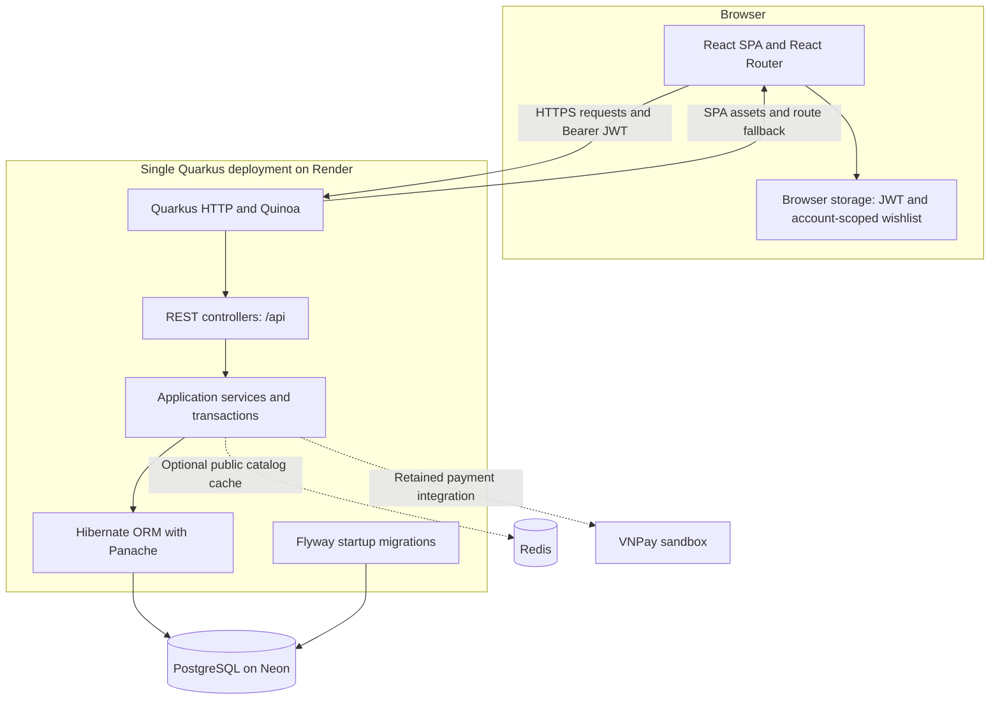

# PhoneZone

### A full-stack storefront for smartphones, tablets, and device repair services.

PhoneZone brings product discovery, shopping, order management, and repair requests into one application, built with **Java, Quarkus, React, and PostgreSQL**.

[](https://github.com/HuyBeros/PhoneZone/actions/workflows/ci.yml)

[Live demo](https://phonezone-app.onrender.com/) · [Tiếng Việt](README.vi.md) · [Deployment guide](docs/deployment.md) · [Report an issue](https://github.com/HuyBeros/PhoneZone/issues)

## Contents

- [Introduction](#introduction)
- [Key features](#key-features)
- [Overall architecture](#overall-architecture)
- [Installation](#installation)
- [Running the project](#running-the-project)
- [Environment configuration](#environment-configuration)
- [Folder structure](#folder-structure)
- [Contribution guidelines](#contribution-guidelines)
- [License](#license)
- [Roadmap](#roadmap)

## Introduction

PhoneZone is a learning and portfolio project that models the workflows of a mobile-device retailer: browsing products, managing a cart, placing orders, redeeming rewards, and requesting repairs. An administration area supports catalog, customer, order, coupon, repair, and contact management.

The project uses a **layered monolith**. Quarkus exposes REST APIs and serves the React single-page application through Quinoa, allowing the frontend and backend to ship as one Docker image. PostgreSQL is the system of record; an optional Redis cache accelerates public catalog reads.

### Try the demo

**Live demo:** [huyberos — PhoneZone](https://phonezone-app.onrender.com/)

| Demo access | Value |
| --- | --- |
| Username | `huyhh` |
| Password | `123456` |

This is a shared demonstration account supplied for the hosted site. It is separate from the development-only accounts created locally. The repository does not automatically create this hosted account.

### Technology stack

| Area | Technologies |
| --- | --- |
| Backend | Java 21, Quarkus 3.34.3, Quarkus REST, Jackson, Bean Validation |
| Persistence | Hibernate ORM with Panache, PostgreSQL 16, Flyway |
| Authentication | SmallRye JWT, RSA signing, bcrypt |
| Frontend | React 18, React Router 7, Vite 6, Chart.js, CSS |
| Frontend integration | Quinoa 2.8.0, managed Node.js 22.22.0 |
| Optional cache | Redis, Quarkus Redis client |
| Delivery | Maven wrapper, npm lockfile, GitHub Actions, Docker |
| Deployment target | Render Web Service and Neon PostgreSQL |

## Key features

### Shopping experience

- Browse smartphones and tablets, view product specifications, and compare up to three products.
- Search, sort, and filter products. The REST API supports keyword, brand, category, price, and pagination parameters; the catalog UI also offers specification filters.
- Manage an authenticated cart, request a checkout quote, place orders, and view order history.
- Save favorites in browser storage, separated by account and hidden after logout.
- Use responsive layouts, request feedback, toast notifications, and route loading fallbacks.

The catalog screen currently filters a fetched subset of up to 200 products. Some catalog views can fall back to bundled sample products if the API is unavailable. Wishlists do not synchronize across devices.

### Accounts and access control

- Register, sign in, update a profile, and change a password.
- Authenticate API requests with RSA-signed JWTs and enforce customer/admin roles.
- Check ownership for protected customer data, including orders and repair details.
- Hash new passwords with bcrypt; upgrade legacy SHA-256 hashes after a successful login.

### Orders, rewards, and service requests

- Calculate prices on the server and update stock within database transactions.
- Redeem reward points for coupons and apply eligible coupons at checkout.
- For **COD/BANK** orders, restore stock and the linked coupon once on cancellation; credit reward points once on completion.
- Charge 50,000 VND shipping unless the product subtotal is **greater than** 10,000,000 VND or an eligible free-shipping coupon applies.
- Award one point per 10,000 VND of discounted merchandise when a COD/BANK order completes.
- Submit repair requests and contact messages.

**Payment status:** COD and manual bank transfer are available. BANK has no automatic reconciliation. The existing VNPay integration remains in source while the sandbox is unavailable; payment processing is unverified. Without merchant credentials, VNPay order creation returns HTTP 503 before an order is written. The COD/BANK rules above should not be assumed to describe the retained VNPay flow.

### Administration and operations

- Manage products, users, orders, coupons, repair requests, and contact messages.
- View dashboard charts populated through HTTP requests.
- Cache public catalog responses with Redis TTLs, post-commit invalidation, and PostgreSQL fallback.
- Initialize new production schemas with Flyway and validate mappings with Hibernate.
- Check database readiness through `GET /api/health`.

## Overall architecture



### Application boundaries

| Layer | Responsibility |
| --- | --- |
| React pages, components, and contexts | Rendering, navigation, forms, client state, API requests |
| Controllers and request DTOs | HTTP contracts, request validation, authorization, responses |
| Services | Business rules, transaction boundaries, stock/coupon/reward handling |
| Entities and Panache | PostgreSQL mappings and persistence queries |
| Catalog cache | JSON response snapshots; never the source of truth for stock or prices |

Production serves assets and APIs from the same origin. In development, Quinoa manages Vite; a standalone Vite server can proxy `/api` to Quarkus. BrowserRouter uses clean paths, while Quinoa provides SPA fallback for direct page navigation.

Redis is optional and is used for public product data, not login sessions, carts, or orders. Catalog writes schedule invalidation after the database transaction commits. See [cache behavior and trade-offs](docs/redis-cache.md).

### API example

```sh
curl "http://localhost:8080/api/products?brand=iPhone&minPrice=5000000&sort=price-asc&page=0&size=20"
```

List responses contain `data`, `total`, `page`, `size`, and `totalPages`. Pages are zero-based; page size must be between 1 and 200.

```sh
curl http://localhost:8080/api/health
# {"status":"UP"}
```

Health returns HTTP 503 with `{"status":"DOWN"}` when the database cannot be reached. For other contracts and checkout rules, see [API behavior](docs/API_CHANGES.md). Generated Swagger/OpenAPI documentation is not installed yet.

## Installation

### Prerequisites

| Requirement | Version or purpose |
| --- | --- |
| JDK | Java 21; set `JAVA_HOME` to the JDK directory |
| Node.js and npm | Recommended Node.js 22.22.0 or later in the 22.x line |
| PostgreSQL | Version 16, installed locally or started with Docker Compose |
| Docker Compose | Optional for local PostgreSQL/Redis; required for the Docker build example |
| Git | Clone the repository and review changes |

A separate Maven installation is optional: use `mvnw` on Linux/macOS or `mvnw.cmd` on Windows. Quinoa can install its configured Node.js version for integrated builds.

### Set up the workspace

```sh
git clone https://github.com/HuyBeros/PhoneZone.git
cd PhoneZone
```

Copy the environment template:

```sh
# Linux / macOS
cp .env.example .env
```

```powershell
# Windows PowerShell
Copy-Item .env.example .env
```

Edit `.env` for your local database, then generate development JWT keys and install frontend dependencies:

```sh
node scripts/setup-dev-keys.mjs
npm --prefix src/main/webui ci
```

Keys are stored in ignored `.local/keys/`. The script preserves an existing complete pair and refuses to continue with an incomplete pair.

### Start supporting services

```sh
docker compose up -d postgres
```

Compose creates `phonezone_db` using the password in `.env`. For an existing local PostgreSQL server, create that database yourself and match `DB_JDBC_URL`, `DB_USERNAME`, and `DB_PASSWORD`. Updating `.env` does not change the password of an already initialized Compose database volume.

Redis is optional:

```sh
docker compose up -d redis
```

Set `CATALOG_CACHE_ENABLED=true` to use it; the environment template explicitly disables cache. If ports 5432 or 6379 are already occupied, reuse the existing services or adjust mapped ports and URLs.

## Running the project

### Integrated development

From the repository root:

```sh
# Linux / macOS
sh mvnw quarkus:dev
```

```powershell
# Windows PowerShell
.\mvnw.cmd quarkus:dev
```

Open [localhost:8080](http://localhost:8080). Quinoa runs the frontend development server alongside Quarkus.

Development mode updates the schema and creates missing local demo users:

| Role | Username | Password |
| --- | --- | --- |
| Administrator | `admin` | `admin123` |
| Customer | `customer` | `customer123` |

Existing passwords are not reset. Production does not create these accounts. An empty database has no product catalog: add products through admin or restore your own reviewed backup. Default coupon definitions are created when the coupon table is empty. Optional file-import endpoints need external JSON datasets that are not shipped in this repository or Docker image.

### Frontend development separately

Keep Quarkus running on port 8080, then use another terminal:

```sh
cd src/main/webui
npm run dev
```

Vite normally starts at [localhost:5173](http://localhost:5173) and proxies `/api` to the backend. Use the URL shown in the terminal if that port is occupied.

### Tests

Frontend commands, from `src/main/webui`:

```sh
npm test
npm run build
```

Backend tests need a **disposable PostgreSQL database** and a **separate Redis instance**. They recreate the test schema and deliberately pause Redis to exercise timeout recovery. Never point test variables at your development or production services.

For a fresh Compose setup:

```sh
docker compose exec postgres createdb -U postgres phonezone_test
docker run --rm -d --name phonezone-redis-test -p 127.0.0.1:6380:6379 redis:7-alpine
```

Create the test database only if it does not already exist. Export test variables in the terminal; do not rely on Maven tests loading the root `.env`:

```powershell
$env:TEST_DB_JDBC_URL = 'jdbc:postgresql://localhost:5432/phonezone_test'
$env:TEST_DB_USERNAME = 'postgres'
$env:TEST_DB_PASSWORD = '<password-of-your-local-test-database>'
$env:TEST_REDIS_URL = 'redis://127.0.0.1:6380'
.\mvnw.cmd --batch-mode '-Dquarkus.quinoa=false' test
```

On Linux/macOS, use `export NAME=value` and `sh mvnw --batch-mode -Dquarkus.quinoa=false test`. After testing, stop the dedicated Redis container with `docker stop phonezone-redis-test`.

CI runs repository checks, frontend tests/build, and backend tests against isolated PostgreSQL/Redis services. Tests cover access control, data ownership, checkout consistency, Redis recovery, admin bootstrap, and schema migration.

### Production build and deployment

```sh
# Linux / macOS
sh mvnw --batch-mode -DskipTests package
```

```powershell
# Windows PowerShell
.\mvnw.cmd --batch-mode '-DskipTests' package
```

After configuring production database/JWT environment variables:

```sh
java -jar target/quarkus-app/quarkus-run.jar
```

Keep the entire `target/quarkus-app/` directory alongside the runnable JAR. This build command skips tests; run the relevant checks separately.

Alternatively, build the deployment image:

```sh
docker build -t phonezone:local .
```

The root Dockerfile builds both applications and runs Java as a non-root user. On Render, create one Docker Web Service, use `/api/health` as its health check, and connect Neon using a JDBC URL with TLS. Production runs Flyway migrations and Hibernate schema validation; existing databases require a reviewed baseline-adoption procedure.

Follow the [Render + Neon deployment guide](docs/deployment.md) for secret files, first-admin bootstrap, new versus existing schemas, and post-deploy checks.

## Environment configuration

Copy [`.env.example`](.env.example) for local development. Quarkus reads the root `.env` during local execution; Render values belong in its Environment settings. Environment variables take precedence over file configuration.

### Database and authentication

| Variable | Local example | Production behavior |
| --- | --- | --- |
| `DB_JDBC_URL` | `jdbc:postgresql://localhost:5432/phonezone_db` | Required; use the Neon JDBC endpoint with `sslmode=require` |
| `DB_USERNAME` | `postgres` | Required; use your Neon role |
| `DB_PASSWORD` | `change-me-local-only` | Required; use a private database password |
| `JWT_PRIVATE_KEY_LOCATION` | `.local/keys/privateKey.pem` | Required; e.g. `/etc/secrets/privateKey.pem` |
| `JWT_PUBLIC_KEY_LOCATION` | `.local/keys/publicKey.pem` | Required; e.g. `/etc/secrets/publicKey.pem` |
| `CORS_ORIGINS` | `http://localhost:8080,http://localhost:5173` | Set your real HTTPS origin; production fallback is the demo origin |
| `PORT` | Usually unset in dev | Read in production; Render supplies it, otherwise port 8080 |

`CORS_ORIGINS` is used by the production profile; development currently permits all origins.

Example Neon connection format, with the password kept in its separate variable:

```dotenv
DB_JDBC_URL=jdbc:postgresql://<neon-host>:5432/<database>?sslmode=require
DB_USERNAME=<neon-role>
DB_PASSWORD=<neon-password>
```

### Optional services and bootstrap

| Variable | Default or purpose |
| --- | --- |
| `CATALOG_CACHE_ENABLED` | Config default: `true` in dev, `false` in prod; `.env.example` sets `false` |
| `REDIS_URL` | `redis://localhost:6379`; use your provider's connection URI for remote Redis |
| `CATALOG_CACHE_NAMESPACE` | `phonezone:catalog:v1`; use separate namespaces per environment/database |
| `CATALOG_CACHE_TTL` | `60s` |
| `VNPAY_TMN_CODE`, `VNPAY_SECRET_KEY` | Empty by default; leave empty while VNPay is unavailable |
| `VNPAY_RETURN_URL` | Local default: `http://localhost:8080/api/payment/vnpay-return` |
| `BOOTSTRAP_ADMIN_ENABLED` | `false`; enable explicitly for first-admin creation |
| `BOOTSTRAP_ADMIN_USERNAME`, `BOOTSTRAP_ADMIN_EMAIL` | Identity for the first administrator |
| `BOOTSTRAP_ADMIN_PASSWORD` | No default; at least 12 characters, within the bcrypt 72-byte UTF-8 limit |

After creating the first administrator, disable bootstrap and remove its password variable. Bootstrap does not reset existing administrators or promote an existing customer.

Generate a **separate production key pair**:

```sh
node scripts/setup-dev-keys.mjs --production
```

The output is stored in `.local/production-keys/`; upload the pair as Render Secret Files. Do not reuse the public test fixtures or former application keys in Git history. Keep real `.env` files, private keys, and database backups out of version control. See the [deployment guide](docs/deployment.md) for credential rotation and existing demo accounts.

## Folder structure

```text
PhoneZone/
├── .github/                       # CI, issue templates, pull-request template
├── .mvn/                          # Maven wrapper configuration
├── docs/
│   ├── deployment.md              # Render/Neon deployment and schema adoption
│   ├── API_CHANGES.md             # API behavior and business rules
│   ├── redis-cache.md             # Cache design and integration testing
│   └── migrations/                # Reviewed SQL for legacy database upgrades
├── scripts/                       # JWT key generation and repository checks
├── src/
│   ├── main/
│   │   ├── java/org/phonezone/
│   │   │   ├── config/            # Shared configuration and exception mappers
│   │   │   ├── controller/        # REST endpoints
│   │   │   ├── dto/               # Request/response models
│   │   │   ├── entity/            # JPA/Panache entities
│   │   │   └── service/           # Business rules, transactions, catalog cache
│   │   ├── resources/
│   │   │   ├── application.properties
│   │   │   └── db/migration/      # Versioned Flyway migrations
│   │   └── webui/
│   │       ├── public/            # Static assets
│   │       ├── src/
│   │       │   ├── api/           # HTTP client and API helpers
│   │       │   ├── components/    # Shared interface components
│   │       │   ├── hooks/         # Reusable React hooks
│   │       │   ├── pages/         # Customer and admin screens
│   │       │   ├── store/         # React Context providers
│   │       │   └── utils/         # Mapping, routing, storage helpers
│   │       ├── package.json
│   │       └── package-lock.json
│   └── test/                      # Backend tests and test-only resources
├── .env.example                   # Documented environment template
├── docker-compose.yml             # Local PostgreSQL and optional Redis
├── Dockerfile                     # Production multi-stage build
├── pom.xml                        # Backend dependencies and build configuration
├── CONTRIBUTING.md
├── LICENSE
├── README.md
└── README.vi.md
```

Frontend tests live alongside the relevant API/utility modules. Generated `target/`, `node_modules/`, `.quinoa/`, and local `.local/` files are intentionally excluded from Git.

## Contribution guidelines

Bug reports, focused improvements, and documentation fixes are welcome.

1. Open an [issue](https://github.com/HuyBeros/PhoneZone/issues) for substantial changes, then create a focused branch.
2. Follow the existing controller/service/DTO boundaries; keep multi-row writes transactional and check both role and ownership requirements.
3. Add a forward-only Flyway migration for schema changes. Do not edit a migration already applied to a deployment.
4. Run checks relevant to your change. For UI changes, verify keyboard access and narrow/mobile layouts.
5. Review the files intended for publication:

   ```sh
   node scripts/check-repository.mjs
   # Stage the intended changes, then:
   node scripts/check-repository.mjs --staged
   git diff --cached --stat
   git diff --cached
   ```

6. Submit a pull request describing the problem, resulting behavior, and validation performed.

The repository checker catches selected generated/local files and secret patterns; it is not a complete security audit. Do not publish private credentials or customer data in commits or issues.

Read [CONTRIBUTING.md](CONTRIBUTING.md) and the [Code of Conduct](CODE_OF_CONDUCT.md). Notable changes are recorded in [CHANGELOG.md](CHANGELOG.md).

## License

Distributed under the **MIT License**. See [LICENSE](LICENSE) for the complete terms. Third-party packages and externally hosted product assets retain their respective licenses and usage terms.

## Roadmap

These items describe planned improvements, not guaranteed delivery dates.

- [x] Customer/admin authentication and role-based API access.
- [x] Catalog, cart, orders, coupons, repair requests, and administration workflows.
- [x] Optional Redis catalog caching with transaction-aware invalidation.
- [x] Account-scoped browser wishlist and responsive layouts.
- [x] CI checks, Flyway initialization, and Render/Neon deployment configuration.
- [ ] Connect catalog UI filtering/pagination to the full server-side result set.
- [ ] Reduce initial JavaScript size and expand loading/error/empty states.
- [ ] Synchronize wishlists through an authenticated backend API.
- [ ] Add OpenAPI/Swagger documentation and browser end-to-end tests.
- [ ] Add email verification, password recovery, login rate limiting, and token refresh/revocation.
- [ ] Resume VNPay end-to-end testing and implement verified IPN/reconciliation when sandbox access returns.
- [ ] Add cloud image uploads and improve operational monitoring.
