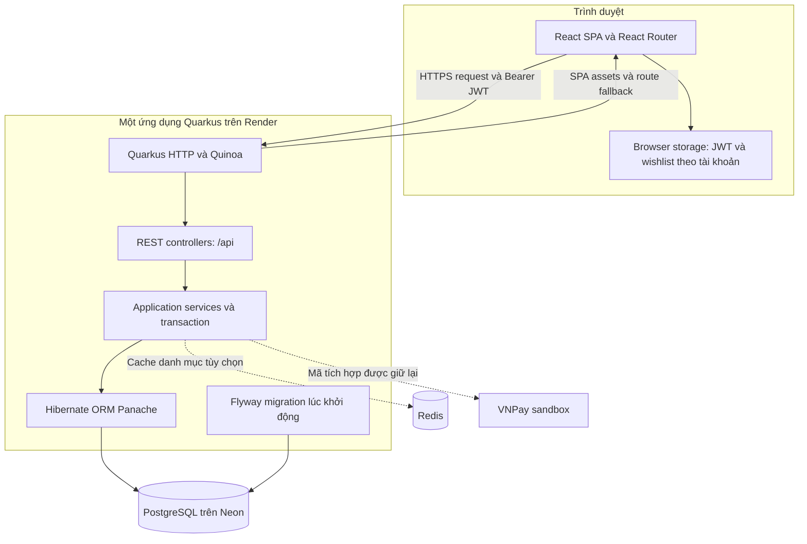

# PhoneZone

### Website bán điện thoại, máy tính bảng và tiếp nhận yêu cầu sửa chữa.

PhoneZone kết hợp khám phá sản phẩm, mua sắm, quản lý đơn hàng và yêu cầu dịch vụ trong một ứng dụng sử dụng **Java, Quarkus, React và PostgreSQL**.

[](https://github.com/HuyBeros/PhoneZone/actions/workflows/ci.yml)

[Live demo](https://phonezone-app.onrender.com/) · [English](README.md) · [Hướng dẫn triển khai](docs/deployment.md) · [Báo lỗi](https://github.com/HuyBeros/PhoneZone/issues)

## Mục lục

- [Giới thiệu](#giới-thiệu)
- [Chức năng chính](#chức-năng-chính)
- [Kiến trúc tổng thể](#kiến-trúc-tổng-thể)
- [Cài đặt](#cài-đặt)
- [Chạy dự án](#chạy-dự-án)
- [Cấu hình môi trường](#cấu-hình-môi-trường)
- [Cấu trúc thư mục](#cấu-trúc-thư-mục)
- [Hướng dẫn đóng góp](#hướng-dẫn-đóng-góp)
- [Giấy phép](#giấy-phép)
- [Lộ trình phát triển](#lộ-trình-phát-triển)

## Giới thiệu

PhoneZone là dự án học tập/portfolio mô phỏng các nghiệp vụ của cửa hàng thiết bị di động: xem sản phẩm, quản lý giỏ hàng, đặt đơn, đổi điểm thưởng và gửi yêu cầu sửa chữa. Khu vực quản trị hỗ trợ quản lý danh mục, khách hàng, đơn hàng, coupon, sửa chữa và liên hệ.

Dự án sử dụng kiến trúc **monolith phân lớp**. Quarkus cung cấp REST API và phục vụ React SPA thông qua Quinoa, cho phép đóng gói frontend/backend trong cùng một Docker image. PostgreSQL lưu dữ liệu chính; Redis tùy chọn hỗ trợ cache danh mục công khai.

### Trải nghiệm demo

**Live demo:** [huyberos — PhoneZone](https://phonezone-app.onrender.com/)

| Thông tin đăng nhập | Giá trị |
| --- | --- |
| Tên đăng nhập | `huyhh` |
| Mật khẩu | `123456` |

Đây là tài khoản trải nghiệm dùng chung được cung cấp cho website demo, khác với tài khoản development tạo trên máy. Repository không tự tạo tài khoản này trên môi trường triển khai.

### Công nghệ sử dụng

| Thành phần | Công nghệ |
| --- | --- |
| Backend | Java 21, Quarkus 3.34.3, Quarkus REST, Jackson, Bean Validation |
| Persistence | Hibernate ORM Panache, PostgreSQL 16, Flyway |
| Xác thực | SmallRye JWT, chữ ký RSA, bcrypt |
| Frontend | React 18, React Router 7, Vite 6, Chart.js, CSS |
| Tích hợp frontend | Quinoa 2.8.0, Node.js 22.22.0 do Quinoa quản lý |
| Cache tùy chọn | Redis, Quarkus Redis client |
| Build và CI | Maven wrapper, npm lockfile, GitHub Actions, Docker |
| Môi trường triển khai | Render Web Service và Neon PostgreSQL |

## Chức năng chính

### Trải nghiệm mua sắm

- Xem điện thoại, máy tính bảng, thông số kỹ thuật và so sánh tối đa ba sản phẩm.
- Tìm kiếm, sắp xếp và lọc sản phẩm. REST API hỗ trợ từ khóa, thương hiệu, danh mục, khoảng giá và phân trang; giao diện danh mục có thêm bộ lọc thông số.
- Quản lý giỏ hàng sau đăng nhập, lấy báo giá checkout, đặt đơn và xem lịch sử.
- Lưu yêu thích tại trình duyệt, tách theo tài khoản và ẩn khi đăng xuất.
- Bố cục responsive, thông báo thao tác, trạng thái chờ request và fallback khi tải route.

Giao diện danh mục hiện lọc trên tập tối đa 200 sản phẩm đã tải. Một số màn hình có thể dùng dữ liệu mẫu đóng gói sẵn khi API không truy cập được. Danh sách yêu thích chưa đồng bộ giữa các thiết bị.

### Tài khoản và phân quyền

- Đăng ký, đăng nhập, cập nhật hồ sơ và đổi mật khẩu.
- Xác thực request bằng JWT ký RSA, phân quyền khách hàng/admin.
- Kiểm tra quyền sở hữu với dữ liệu riêng như đơn hàng và chi tiết phiếu sửa chữa.
- Hash mật khẩu mới bằng bcrypt; nâng cấp hash SHA-256 cũ sau lần đăng nhập hợp lệ.

### Đơn hàng, điểm thưởng và dịch vụ

- Tính tiền tại server và cập nhật tồn kho trong database transaction.
- Đổi điểm lấy coupon, áp dụng coupon đủ điều kiện khi checkout.
- Với đơn **COD/BANK**, hủy đơn hoàn tồn kho/coupon một lần; hoàn thành đơn cộng điểm một lần.
- Phí ship 50.000đ; miễn khi tiền sản phẩm **trên** 10.000.000đ hoặc có coupon miễn ship phù hợp.
- Mỗi 10.000đ tiền sản phẩm sau giảm giá được một điểm khi đơn COD/BANK hoàn thành.
- Gửi yêu cầu sửa chữa và thông tin liên hệ.

**Trạng thái thanh toán:** hỗ trợ COD và chuyển khoản thủ công; BANK chưa có đối soát tự động. Mã tích hợp VNPay được giữ trong thời gian sandbox không hoạt động, chưa xác nhận thanh toán. Khi thiếu merchant/key, tạo đơn VNPay trả HTTP 503 trước khi ghi đơn. Không áp dụng mặc định các quy tắc COD/BANK bên trên cho luồng VNPay cũ.

### Quản trị và vận hành

- Quản lý sản phẩm, người dùng, đơn hàng, coupon, sửa chữa và liên hệ.
- Dashboard có biểu đồ, lấy dữ liệu qua HTTP.
- Redis cache danh mục với TTL, vô hiệu hóa sau commit và fallback PostgreSQL.
- Flyway tạo schema production mới; Hibernate kiểm tra tính tương thích của schema.
- Endpoint `GET /api/health` kiểm tra kết nối database.

## Kiến trúc tổng thể



### Trách nhiệm từng lớp

| Lớp | Trách nhiệm |
| --- | --- |
| React pages, components, contexts | Giao diện, điều hướng, form, trạng thái client và gọi API |
| Controller và request DTO | Hợp đồng HTTP, validation, phân quyền và response |
| Service | Nghiệp vụ, transaction, xử lý tồn kho/coupon/điểm thưởng |
| Entity và Panache | Ánh xạ dữ liệu và truy vấn PostgreSQL |
| Catalog cache | Lưu snapshot JSON; không quyết định tồn kho hoặc giá chính thức |

Production phục vụ assets và API cùng origin. Khi dev, Quinoa quản lý Vite; nếu chạy Vite riêng, `/api` được proxy sang Quarkus. BrowserRouter dùng đường dẫn không có `#`; Quinoa xử lý SPA fallback khi truy cập trực tiếp các trang.

Redis chỉ dùng cho danh mục công khai, không lưu phiên đăng nhập, giỏ hàng hoặc đơn hàng. Thay đổi danh mục lên lịch vô hiệu hóa cache sau khi database commit. Xem [thiết kế và giới hạn cache](docs/redis-cache.md).

### Ví dụ API

```sh
curl "http://localhost:8080/api/products?brand=iPhone&minPrice=5000000&sort=price-asc&page=0&size=20"
```

Response danh sách có `data`, `total`, `page`, `size`, `totalPages`. Trang bắt đầu từ 0; `size` từ 1 đến 200.

```sh
curl http://localhost:8080/api/health
# {"status":"UP"}
```

Khi không kết nối database được, health trả HTTP 503 với `{"status":"DOWN"}`. Xem [hành vi API](docs/API_CHANGES.md) để biết quy tắc checkout và các hợp đồng khác. Hiện chưa cài Swagger/OpenAPI tự sinh.

## Cài đặt

### Yêu cầu

| Thành phần | Phiên bản hoặc mục đích |
| --- | --- |
| JDK | Java 21; `JAVA_HOME` trỏ đến thư mục JDK |
| Node.js và npm | Khuyến nghị từ Node.js 22.22.0 thuộc nhánh 22.x |
| PostgreSQL | Phiên bản 16, cài local hoặc chạy bằng Compose |
| Docker Compose | Tùy chọn cho PostgreSQL/Redis; cần Docker để build image |
| Git | Clone và quản lý mã nguồn |

Có thể dùng Maven wrapper mà không cài Maven riêng: `mvnw` trên Linux/macOS, `mvnw.cmd` trên Windows. Quinoa có thể tự cài phiên bản Node.js đã cấu hình khi build tích hợp.

### Chuẩn bị workspace

```sh
git clone https://github.com/HuyBeros/PhoneZone.git
cd PhoneZone
```

Copy cấu hình mẫu:

```sh
# Linux / macOS
cp .env.example .env
```

```powershell
# Windows PowerShell
Copy-Item .env.example .env
```

Sửa thông tin database trong `.env`, sinh JWT key development và cài dependency frontend:

```sh
node scripts/setup-dev-keys.mjs
npm --prefix src/main/webui ci
```

Khóa nằm trong `.local/keys/`, đã được Git bỏ qua. Script giữ nguyên cặp khóa đầy đủ đã tồn tại và báo lỗi nếu chỉ còn một trong hai file.

### Khởi động dịch vụ phụ trợ

```sh
docker compose up -d postgres
```

Compose tạo `phonezone_db`, dùng mật khẩu trong `.env`. Nếu dùng PostgreSQL đã cài sẵn, tự tạo database này và sửa `DB_JDBC_URL`, `DB_USERNAME`, `DB_PASSWORD`. Đổi `.env` không tự đổi mật khẩu của database volume Compose đã khởi tạo.

Redis là tùy chọn:

```sh
docker compose up -d redis
```

Đặt `CATALOG_CACHE_ENABLED=true` để bật; template môi trường hiện tắt cache. Nếu cổng 5432/6379 đã được dùng, tận dụng dịch vụ đang có hoặc đổi port mapping và URL.

## Chạy dự án

### Chạy tích hợp khi phát triển

Tại thư mục gốc:

```sh
# Linux / macOS
sh mvnw quarkus:dev
```

```powershell
# Windows PowerShell
.\mvnw.cmd quarkus:dev
```

Mở [localhost:8080](http://localhost:8080). Quinoa chạy frontend development server cùng Quarkus.

Dev tự cập nhật schema và tạo tài khoản local còn thiếu:

| Vai trò | Tên đăng nhập | Mật khẩu |
| --- | --- | --- |
| Quản trị viên | `admin` | `admin123` |
| Khách hàng | `customer` | `customer123` |

Không đặt lại mật khẩu đã có; production không tạo tài khoản demo này. Database mới chưa có sản phẩm: thêm qua admin hoặc khôi phục bản sao dữ liệu đã kiểm tra. Bảng coupon rỗng được tạo một số coupon mặc định. Các endpoint import cần JSON bên ngoài, chưa có trong repository/image Docker.

### Chạy frontend riêng

Giữ Quarkus ở cổng 8080 và mở terminal khác:

```sh
cd src/main/webui
npm run dev
```

Vite thường chạy tại [localhost:5173](http://localhost:5173), proxy `/api` sang backend. Dùng địa chỉ terminal thông báo nếu cổng đã bận.

### Kiểm thử

Tại `src/main/webui`:

```sh
npm test
npm run build
```

Backend test cần **database PostgreSQL riêng có thể xóa** và **Redis riêng**. Bộ test tạo lại schema và chủ động pause Redis để kiểm tra phục hồi sau timeout. Không trỏ biến test đến dịch vụ development/production đang chứa dữ liệu.

Với Compose mới cài:

```sh
docker compose exec postgres createdb -U postgres phonezone_test
docker run --rm -d --name phonezone-redis-test -p 127.0.0.1:6380:6379 redis:7-alpine
```

Chỉ tạo database test nếu chưa tồn tại. Truyền biến môi trường trong terminal, không dựa vào Maven test tự đọc `.env` gốc:

```powershell
$env:TEST_DB_JDBC_URL = 'jdbc:postgresql://localhost:5432/phonezone_test'
$env:TEST_DB_USERNAME = 'postgres'
$env:TEST_DB_PASSWORD = '<mat-khau-database-test-local>'
$env:TEST_REDIS_URL = 'redis://127.0.0.1:6380'
.\mvnw.cmd --batch-mode '-Dquarkus.quinoa=false' test
```

Linux/macOS dùng `export NAME=value` và `sh mvnw --batch-mode -Dquarkus.quinoa=false test`. Sau kiểm thử, dừng Redis riêng bằng `docker stop phonezone-redis-test`.

CI kiểm tra repository, test/build frontend và test backend bằng PostgreSQL/Redis riêng. Bộ test gồm phân quyền, quyền sở hữu dữ liệu, tính nhất quán checkout, Redis phục hồi, admin bootstrap và migration schema.

### Build và triển khai production

```sh
# Linux / macOS
sh mvnw --batch-mode -DskipTests package
```

```powershell
# Windows PowerShell
.\mvnw.cmd --batch-mode '-DskipTests' package
```

Sau khi đặt biến môi trường database/JWT production:

```sh
java -jar target/quarkus-app/quarkus-run.jar
```

Cần giữ toàn bộ thư mục `target/quarkus-app/` cạnh JAR. Lệnh build trên bỏ qua test; chạy các kiểm thử liên quan riêng trước đó.

Hoặc build image triển khai:

```sh
docker build -t phonezone:local .
```

Dockerfile gốc build cả frontend/backend và chạy Java bằng user không phải root. Trên Render, tạo một Docker Web Service, đặt health check `/api/health`, kết nối Neon bằng JDBC URL có TLS. Production chạy Flyway rồi Hibernate validate; database cũ cần quy trình đối chiếu/adopt baseline.

Xem [hướng dẫn Render + Neon](docs/deployment.md) để cấu hình Secret Files, tạo admin lần đầu, xử lý database mới/cũ và kiểm tra sau deploy.

## Cấu hình môi trường

Copy [`.env.example`](.env.example) để chạy local. Quarkus đọc `.env` tại gốc khi chạy ở đó; đặt cấu hình Render trong Environment của dịch vụ. Biến môi trường được ưu tiên hơn cấu hình trong file.

### Database và xác thực

| Biến | Ví dụ local | Production |
| --- | --- | --- |
| `DB_JDBC_URL` | `jdbc:postgresql://localhost:5432/phonezone_db` | Bắt buộc; JDBC endpoint Neon có `sslmode=require` |
| `DB_USERNAME` | `postgres` | Bắt buộc; role Neon |
| `DB_PASSWORD` | `change-me-local-only` | Bắt buộc; mật khẩu database riêng |
| `JWT_PRIVATE_KEY_LOCATION` | `.local/keys/privateKey.pem` | Bắt buộc; ví dụ `/etc/secrets/privateKey.pem` |
| `JWT_PUBLIC_KEY_LOCATION` | `.local/keys/publicKey.pem` | Bắt buộc; ví dụ `/etc/secrets/publicKey.pem` |
| `CORS_ORIGINS` | `http://localhost:8080,http://localhost:5173` | Origin HTTPS thật; fallback production là origin demo |
| `PORT` | Thường không đặt khi dev | Production đọc biến Render cung cấp, fallback 8080 |

`CORS_ORIGINS` được cấu hình ứng dụng sử dụng trong profile production; development hiện cho phép mọi origin.

Ví dụ định dạng Neon, không ghép mật khẩu vào JDBC URL:

```dotenv
DB_JDBC_URL=jdbc:postgresql://<neon-host>:5432/<database>?sslmode=require
DB_USERNAME=<neon-role>
DB_PASSWORD=<neon-password>
```

### Dịch vụ tùy chọn và bootstrap

| Biến | Mặc định hoặc mục đích |
| --- | --- |
| `CATALOG_CACHE_ENABLED` | Config mặc định `true` ở dev, `false` ở prod; `.env.example` đặt `false` |
| `REDIS_URL` | `redis://localhost:6379`; dùng URI nhà cung cấp khi chạy remote |
| `CATALOG_CACHE_NAMESPACE` | `phonezone:catalog:v1`; tách namespace theo môi trường/database |
| `CATALOG_CACHE_TTL` | `60s` |
| `VNPAY_TMN_CODE`, `VNPAY_SECRET_KEY` | Mặc định trống; giữ trống khi VNPay chưa hoạt động |
| `VNPAY_RETURN_URL` | Local mặc định `http://localhost:8080/api/payment/vnpay-return` |
| `BOOTSTRAP_ADMIN_ENABLED` | `false`; bật rõ ràng khi tạo admin lần đầu |
| `BOOTSTRAP_ADMIN_USERNAME`, `BOOTSTRAP_ADMIN_EMAIL` | Định danh quản trị viên đầu tiên |
| `BOOTSTRAP_ADMIN_PASSWORD` | Không có mặc định; ít nhất 12 ký tự, tối đa 72 byte UTF-8 theo bcrypt |

Sau khi tạo admin, tắt bootstrap và bỏ biến mật khẩu. Bootstrap không đặt lại mật khẩu admin đã có hoặc nâng quyền tài khoản khách hàng tồn tại.

Sinh **cặp khóa production riêng**:

```sh
node scripts/setup-dev-keys.mjs --production
```

Khóa được lưu tại `.local/production-keys/`; đưa cặp khóa vào Render Secret Files. Không dùng fixture test công khai hoặc khóa ứng dụng cũ trong lịch sử Git. Không commit `.env` thật, private key và database backup. Xem [hướng dẫn triển khai](docs/deployment.md) cho việc thay credential và xử lý tài khoản demo cũ.

## Cấu trúc thư mục

```text
PhoneZone/
├── .github/                       # CI, issue và pull-request templates
├── .mvn/                          # Cấu hình Maven wrapper
├── docs/
│   ├── deployment.md              # Render/Neon và adopt schema cũ
│   ├── API_CHANGES.md             # Hành vi API và quy tắc nghiệp vụ
│   ├── redis-cache.md             # Thiết kế cache và integration test
│   └── migrations/                # SQL nâng cấp database cũ cần review
├── scripts/                       # Sinh JWT key và kiểm tra repository
├── src/
│   ├── main/
│   │   ├── java/org/phonezone/
│   │   │   ├── config/            # Cấu hình và exception mapper
│   │   │   ├── controller/        # REST endpoint
│   │   │   ├── dto/               # Request/response models
│   │   │   ├── entity/            # JPA/Panache entities
│   │   │   └── service/           # Nghiệp vụ, transaction, catalog cache
│   │   ├── resources/
│   │   │   ├── application.properties
│   │   │   └── db/migration/      # Flyway migration có version
│   │   └── webui/
│   │       ├── public/            # Static assets
│   │       ├── src/
│   │       │   ├── api/           # HTTP client và API helpers
│   │       │   ├── components/    # Component dùng chung
│   │       │   ├── hooks/         # React hooks tái sử dụng
│   │       │   ├── pages/         # Màn hình khách hàng và admin
│   │       │   ├── store/         # React Context providers
│   │       │   └── utils/         # Mapping, routing, storage helpers
│   │       ├── package.json
│   │       └── package-lock.json
│   └── test/                      # Backend tests và tài nguyên test riêng
├── .env.example                   # Template biến môi trường
├── docker-compose.yml             # PostgreSQL local và Redis tùy chọn
├── Dockerfile                     # Build production nhiều giai đoạn
├── pom.xml                        # Dependency và cấu hình build backend
├── CONTRIBUTING.md
├── LICENSE
├── README.md
└── README.vi.md
```

Frontend test đặt cạnh module API/utility tương ứng. `target/`, `node_modules/`, `.quinoa/` và `.local/` là tài nguyên sinh ra/local, được loại khỏi Git.

## Hướng dẫn đóng góp

Hoan nghênh báo lỗi, cải tiến có phạm vi rõ ràng và chỉnh sửa tài liệu.

1. Mở [issue](https://github.com/HuyBeros/PhoneZone/issues) cho thay đổi lớn, sau đó tạo nhánh riêng.
2. Giữ ranh giới controller/service/DTO; thao tác nhiều dòng dữ liệu cần transaction, API riêng cần kiểm tra vai trò và quyền sở hữu.
3. Thêm Flyway migration mới cho thay đổi schema; không sửa migration đã áp dụng trên môi trường triển khai.
4. Chạy kiểm tra liên quan; với UI, kiểm tra bàn phím và màn hình nhỏ/mobile.
5. Rà các file chuẩn bị công khai:

   ```sh
   node scripts/check-repository.mjs
   # Stage các thay đổi mong muốn, sau đó:
   node scripts/check-repository.mjs --staged
   git diff --cached --stat
   git diff --cached
   ```

6. Tạo pull request mô tả vấn đề, hành vi sau sửa và cách kiểm chứng.

Script chỉ kiểm tra một số loại file/mẫu secret, không phải kiểm toán bảo mật đầy đủ. Không đưa credential riêng hoặc dữ liệu khách hàng vào commit/issue.

Xem [CONTRIBUTING.md](CONTRIBUTING.md), [Code of Conduct](CODE_OF_CONDUCT.md) và lịch sử thay đổi tại [CHANGELOG.md](CHANGELOG.md).

## Giấy phép

Dự án được phân phối theo **MIT License**. Xem [LICENSE](LICENSE) để biết điều khoản đầy đủ. Dependency và tài nguyên sản phẩm từ bên ngoài tuân theo giấy phép/điều khoản tương ứng.

## Lộ trình phát triển

Các mục dưới đây là định hướng cải tiến, chưa có cam kết thời điểm hoàn thành.

- [x] Xác thực khách hàng/admin và phân quyền API.
- [x] Danh mục, giỏ hàng, đơn hàng, coupon, sửa chữa và quản trị.
- [x] Redis cache danh mục tùy chọn, vô hiệu hóa theo transaction.
- [x] Wishlist trình duyệt theo tài khoản và giao diện responsive.
- [x] CI, Flyway và cấu hình triển khai Render/Neon.
- [ ] Kết nối bộ lọc/phân trang UI với toàn bộ kết quả phía server.
- [ ] Giảm JavaScript ban đầu, mở rộng trạng thái loading/error/empty.
- [ ] Đồng bộ wishlist qua backend API có xác thực.
- [ ] Bổ sung OpenAPI/Swagger và browser end-to-end tests.
- [ ] Xác minh email, khôi phục mật khẩu, rate limit login và refresh/revoke token.
- [ ] Kiểm thử lại VNPay, bổ sung IPN/đối soát có xác minh khi sandbox hoạt động.
- [ ] Upload ảnh cloud và cải thiện giám sát vận hành.
